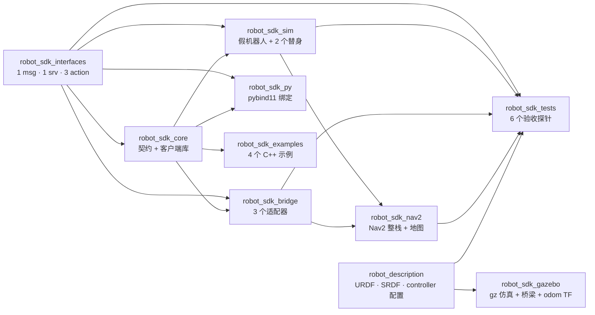
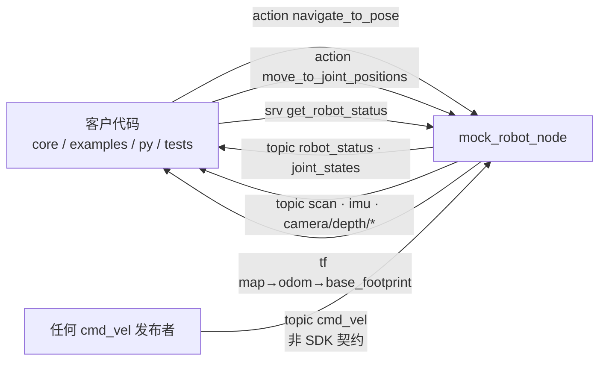
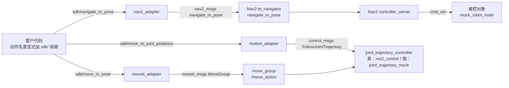
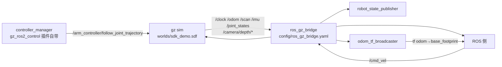
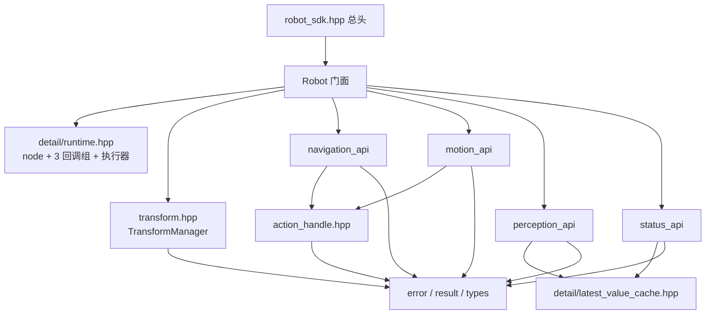
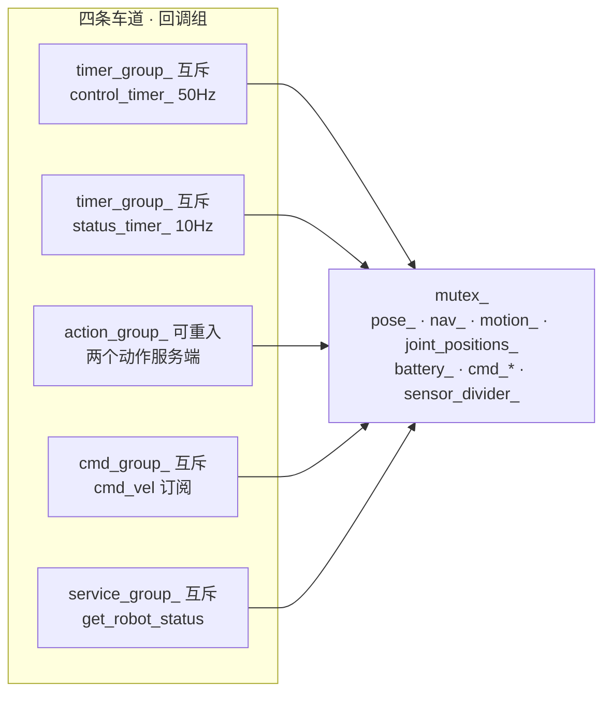
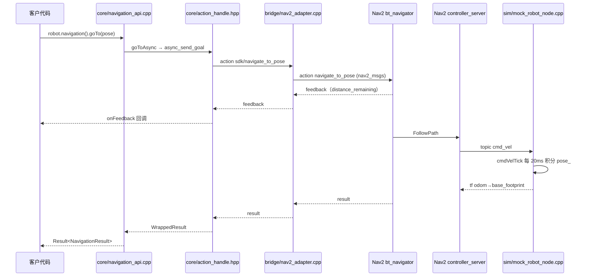

# 文件地图：每个文件干什么、谁调用谁

> **这份文档解决一个问题**：想改某处 / 想找某功能时，该打开哪个文件。
> 它是**文件级索引**，不重复讲设计理由。
>
> **和另外几份的分工**
> - [`robot-flows.md`](robot-flows.md) —— 机器人怎么动起来的（业务流转全图，三条路对照）
> - [`sdk-call-flow.md`](sdk-call-flow.md) —— SDK 怎么被调用，`spin()` 在干什么
> - [`mock-robot-node.md`](mock-robot-node.md) —— mock **为什么**这样设计（并发模型 / 三条铁律）
> - [`visualization.md`](visualization.md) —— 怎么看机器人在哪
> - **本文** —— **哪个文件装了什么**，以及它们之间怎么连起来

**三种读法**（按你的目的挑一条）：

| 你的目的 | 从哪开始 |
|---|---|
| 我想**跑起来** | §5 三条可跑链路 → 对应包的 launch 文件 |
| 我想**改某个行为** | §7 找功能索引 |
| 我想**搞懂结构** | §1 全局图 → §4 接线总表 → 你关心的那个包 |

---

## 1. 全局：10 个包



| 包 | 角色 | 关键产物 |
|---|---|---|
| `robot_sdk_interfaces` | **契约**：消息 / 服务 / 动作定义 | 3 个 action、1 个 srv、1 个 msg |
| `robot_sdk_core` | **SDK 本体**：`Robot` 门面 + 4 个能力 API，客户只依赖它 | 静态库 `robot_sdk_core` |
| `robot_sdk_sim` | **假机器人**（默认后端）+ 两个假下游 | 3 个可执行文件 |
| `robot_sdk_bridge` | **适配层**：把 Nav2 / ros2_control / MoveIt 翻译成 SDK 契约 | 3 个适配器可执行文件 |
| `robot_sdk_nav2` | Nav2 最小整栈 launch + 参数 + 预置地图 | 1 个 launch |
| `robot_description` | 机器人唯一描述源 + 执行侧/规划侧 launch | xacro→urdf、srdf、5 份 config |
| `robot_sdk_gazebo` | Gazebo 仿真链 | 1 个 launch + 桥配置 + world |
| `robot_sdk_py` | 同一份核心的 Python 投影 | 1 个扩展模块 |
| `robot_sdk_examples` | 客户代码长什么样 | 4 个示例 |
| `robot_sdk_tests` | 行为验收（探针 + pytest 壳） | 6 探针 + 2 链 launch |

### 1.1 六个分层（比包名更有用）

```
① 契约层   robot_sdk_interfaces      只放 .msg/.srv/.action，没有代码
② 客户层   robot_sdk_core            ☆ 客户代码只依赖这一层
           robot_sdk_py / examples   客户代码的两种写法
③ 执行层   robot_sdk_sim             mock = 默认执行侧（自己实现契约）
           robot_sdk_bridge          适配器 = 把真后端接上契约
④ 后端层   robot_sdk_nav2            Nav2 整栈
           robot_description         ros2_control + MoveIt 的配置与 launch
           robot_sdk_gazebo          Gazebo 物理仿真
⑤ 验收层   robot_sdk_tests           探针（不在生产路径上）
```

**一句话记住**：`core` 定义**怎么问**，`sim` 与 `bridge` 提供**谁来答**，`nav2 / description / gazebo` 是**真答案**，`tests` 负责**验答案**。

---

## 2. 关键区分：编译期依赖 ≠ 运行期接线

这是本项目最容易看错的一点。**包之间几乎没有编译期依赖**：

- `robot_sdk_bridge` **不**依赖 `robot_sdk_nav2`（它只认 `nav2_msgs`）
- `robot_sdk_nav2` **不**依赖 `robot_sdk_bridge` 的代码（launch 里按可执行文件名起）
- `robot_sdk_gazebo` **不**依赖 `robot_sdk_bridge` / `robot_sdk_core`
- 所有耦合都发生在**话题名 / 动作名 / 服务名**这一层

所以图要读两张：**"谁 include 谁"（§1）**和**"谁跟谁说话"（下节）**。

### 2.1 模式 A：客户直连 mock（默认，最简单）



> `robot.tf()`（`currentPose`）走的是 **TF**，不是话题 —— 所以 mock 必须广播 TF 才有一条能查到位姿的路。

**这个模式里没有服务端的东西**：`motion().moveToPose(...)`（动作名 `move_to_pose`）**没有服务端** → 会等超时。
`MoveToPose` 只有 `moveit_adapter` 提供（见模式 B）。

### 2.2 模式 B：经过适配器（把真后端接上）



### 2.3 模式 C：Gazebo（gz 与 ROS 的桥）



> 为什么需要 `odom_tf_broadcaster`：gz 的差速驱动插件只发 `/odom` **话题**、不发 TF，而 Nav2 要 `odom→base` 这条链。它就是把话题补成 TF 的那一小段代码。

---

## 3. 逐包文件表

### 3.1 `robot_sdk_interfaces` —— 契约

**一句话**：全部对外契约的定义处，没有一行算法。客户依赖这里，所以**换后端不破坏客户代码**。

| 文件 | 职责 | 字段要点 |
|---|---|---|
| `msg/RobotStatus.msg` | 机器人状态**位**与遥测：state_bits 位掩码（底盘/臂在动、充电、急停、低电）+ 电量 + 故障码 | `state_bits`、`battery_percentage`、`error_code`、`uptime_seconds` |
| `srv/GetRobotStatus.srv` | 同步状态查询（与状态话题互补） | req `include_joint_states` → resp `success/message/status/joint_states` |
| `action/NavigateToPose.action` | 平面导航目标 | Goal `target_pose`+`max_speed`+`avoid_obstacles` |
| `action/MoveToJointPositions.action` | 关节空间运动目标 | Goal `target`(JointState)+`max_velocity`+`max_acceleration` |
| `action/MoveToPose.action` | 笛卡尔目标（逆解交给执行侧） | Goal `target_pose`+`any_orientation`+`max_velocity` |
| `CMakeLists.txt` / `package.xml` | `rosidl_generate_interfaces` 生成代码 | 依赖 std_msgs/sensor_msgs/geometry_msgs |

**三个 action 共同的设计约定**（写在定义文件的注释里，值得读）
- `max_velocity` / `max_acceleration` 为 **0 表示"由执行侧按自己上限决定"** —— 而不是"不动"。
- 不暴露 `max_speed` 之外的速度缩放**比例**（那会把客户和具体后端的调参模型绑死）。
- Result 有**两层语义**：`success`（业务成功）≠ `Result.ok()`（通信层拿到结果）。两层都要查。

---

### 3.2 `robot_sdk_core` —— SDK 本体

**一句话**：客户唯一需要依赖的包。`Robot` 门面把 node / 执行器 / TF / 四个能力 API 装配起来，**公开接口不抛异常**（走 `Result<T>`）。

#### public 头（客户可见，共 13 个）

| 文件 | 职责 | 关键符号 |
|---|---|---|
| `robot_sdk.hpp` | **总头**：一次拉进全部公开 API（**故意不含 `detail/`**） | 纯 `#include` |
| `robot.hpp` | 门面类：装配 runtime + 4 API + TransformManager | `class Robot`、`navigation()/motion()/perception()/status()/tf()` |
| `config.hpp` | 全部配置结构 + 默认值 + `fromNode()` 读 ROS 参数 | `RobotConfig` / `NavigationConfig` / `MotionConfig` / `PerceptionConfig` / `StatusConfig` |
| `types.hpp` | 平面位姿 `Pose2D` 与角度/四元数纯函数 | `normalizeAngle`、`yawFromQuaternion`、`toPose2D` |
| `result.hpp` | 要么值要么错误；越界取 `value()` 才抛 | `Result<T>`、`SdkException` |
| `error.hpp` | 与传输层无关的稳定错误分类 | `ErrorCode`、`Error::Timeout()` 等工厂 |
| `transform.hpp` | tf2 薄封装：把 tf2 异常翻成 `Result`/`Error`，带超时查询 | `TransformManager` |
| `action_handle.hpp` | 交给客户的**非阻塞**动作句柄 | `ActionHandle`：`bind/onFeedback/waitForAcceptance/cancel/wait` |
| `navigation_api.hpp` | 导航能力 | `NavigationAPI`：`goToAsync/goTo/currentPose/serverAvailable/cancelAll` |
| `motion_api.hpp` | 运动能力（关节 / 笛卡尔 / 夹爪 / 具名目标） | `MotionAPI`：`moveToJointPositions(Async)`、`moveToPose(Async)`、`home`、`setGripper` |
| `perception_api.hpp` | 传感器访问（最新样本 + 阻塞等待） | `PerceptionAPI`：`laserScan/imu/depthImage/pointCloud/nearestObstacleDistance` |
| `status_api.hpp` | 状态（缓存快照 + 服务查询 + 订阅回调） | `StatusAPI`：`status/queryStatus/isHealthy/batteryPercentage` |
| `version.hpp` | 编译期版本常量 | `kVersionString` |

#### `detail/` 内部件（**客户不该依赖**，但被测试和别的包复用）

| 文件 | 职责 | 谁在用 |
|---|---|---|
| `detail/runtime.hpp` | 持有 node + **三个回调组** + 多线程执行器（线程语义之家） | `robot.cpp` |
| `detail/latest_value_cache.hpp` | 线程安全的"最新样本"容器 + 条件变量等待（**纯 std，无 ROS**） | perception / status |
| `detail/scan_utils.hpp` | 角度窗口内求激光最近有效回波（**纯函数**） | `perception_api.cpp` |
| `detail/joint_wrap.hpp` | 连续关节最短角差（**纯 std**） | `mock_robot_node` / 适配器 |
| `detail/action_util.hpp` | `ResultCode` → 可读字符串 | motion / navigation api |
| **`detail/action_slot.hpp`** | **动作服务端的单目标状态机**（Idle/Reserved/Running + 取消信箱） | **`sim` 与 `bridge` 的服务端** ← 见下 |

> ⚠️ `action_slot.hpp` 这个头**在 core 内部没有任何人用**，它是给**服务端侧**（`robot_sdk_sim` 的 `mock_robot_node`、`robot_sdk_bridge` 的三个适配器）共用的。它把"同时只服务一个目标"这件事收成一个枚举 —— 三态而非三个 bool，因为 8 种组合里只有 4 种合法。
> 被 include 的地方：`robot_sdk_sim/include/robot_sdk_sim/tick_action.hpp`、`robot_sdk_sim/include/robot_sdk_sim/mock_robot_node.hpp`、`robot_sdk_bridge/src/*.cpp`。

#### `src/` 实现

| 文件 | 职责 | 关键函数 |
|---|---|---|
| `src/robot.cpp` | **唯一装配点**：建 TransformManager + 四个 API，把 spin 转给 runtime | `Robot(...)`、`spin/spinSome/stop` |
| `src/runtime.cpp` | 建节点（注入 `use_sim_time`）、三个回调组、多线程执行器 | `RobotRuntime::setup/spin/spinSome/stop` |
| `src/config.cpp` | `fromNode`：声明并读回镜像结构体路径的参数名 | `getExistingOrDeclare` |
| `src/navigation_api.cpp` | 发导航目标、翻译反馈/结果、`currentPose` 走 TF | `goToAsync`、`toResult`、`currentPose` |
| `src/motion_api.cpp` | 两个 action 客户端 + 参数校验 + 取消 | `validate`、`moveToPoseAsync`、`cancelAll` |
| `src/perception_api.cpp` | 五个订阅（SensorDataQoS + sensor 回调组）+ 阻塞等待 | `waitForCache`、`nearestObstacleDistance` |
| `src/status_api.cpp` | 状态/关节订阅 + 状态服务客户端 | `queryStatus`、`isHealthy` |
| `src/transform.cpp` | Buffer/Listener 组装、QoS 覆盖、查询异常→Error | `lookupTransform`、`currentPose` |

#### `test/` 单元测试（12 个，纯核心逻辑，不需要机器人）

| 文件 | 在测什么 |
|---|---|
| `test_error.cpp` / `test_result.cpp` / `test_types.cpp` | 值类型：错误码、`Result` 语义、角度/四元数往返 |
| `test_config.cpp` | 默认值可用 + 参数覆盖 + 命名空间展开 |
| `test_latest_value_cache.cpp` | 缓存只留最新 + `waitForNext` 必须等到更新的样本 |
| `test_perception_helpers.cpp` | `nearestObstacleDistance` 忽略 NaN/inf/量程外 |
| `test_joint_wrap.cpp` | 走最短一边、结果恒在 (−π, π] |
| `test_action_util.cpp` | 结果码全覆盖（**兼头文件自包含性测试**） |
| `test_transform.cpp` | tf 封装：缺帧→`Unavailable`、发静态变换后能查到 |
| `test_navigation_api.cpp` / `test_motion_api.cpp` | 无服务端时的退化路径、`cancelAll` 容忍空表 |
| `test_robot.cpp` | 门面装配、寄生模式不抢线程（**兼 umbrella 自包含性测试**） |

#### core 内部接线



**与 ROS 的耦合分档**（决定哪部分能脱 ROS 复用）

| 档 | 文件 | 能不能脱 ROS |
|---|---|---|
| 完全无 ROS | `error.hpp`、`result.hpp`、`version.hpp`、`detail/latest_value_cache.hpp`、`detail/joint_wrap.hpp` | ✅ 纯标准库 |
| 只要消息/数学类型 | `types.hpp`、`detail/scan_utils.hpp` | ✅ 无 `rclcpp` 运行时 |
| 只要 `rclcpp_action` | `action_handle.hpp`、`detail/action_slot.hpp`、`detail/action_util.hpp` | 半 |
| 要 `rclcpp` 运行时 | `robot.hpp`、`config.hpp`、`transform.hpp`、四个 `*_api.hpp`、`detail/runtime.hpp`、全部 `src/*.cpp` | ❌ |

---

### 3.3 `robot_sdk_bridge` —— 适配层

**一句话**：把"别的栈"的动作翻译成 SDK 契约。三个适配器结构完全同构（服务端 + 客户端 + 一张翻译表），**没有定时器、没有本地状态要推进**。

| 文件 | 服务端（SDK 侧） | 客户端（后端侧） | 翻译要点 |
|---|---|---|---|
| `src/nav2_adapter.cpp` | `sdk/navigate_to_pose`<br/>`robot_sdk_interfaces/NavigateToPose` | `navigate_to_pose`<br/>`nav2_msgs/NavigateToPose` | 空 frame 补 `default_frame`；`behavior_tree` 每次发目标时读参数（改了就生效）|
| `src/motion_adapter.cpp` | `sdk/move_to_joint_positions` | `/joint_trajectory_controller/follow_joint_trajectory`<br/>`control_msgs/FollowJointTrajectory` | 一个目标点 → **补成两点整条轨迹**（起点取 `/joint_states`）；速度/加速度折成**时长** |
| `src/moveit_adapter.cpp` | `sdk/move_to_pose` | `/move_action`<br/>`moveit_msgs/MoveGroup` | 位姿 → `Constraints`（位置球 + 姿态锥）；沿路查 TF 估完成度 |
| `launch/adapters.launch.py` | 只起 `nav2_adapter` | — | 三个参数：`sdk_action_name` / `nav2_action_name` / `default_frame` |
| `CMakeLists.txt` / `package.xml` | 建 3 个可执行文件 | — | 依赖 nav2_msgs / control_msgs / moveit_msgs / shape_msgs |

**三个适配器共同的结构**（认这个结构就能读懂任何一个）

```cpp
handleGoal()      → slot_.reserve()   // 占位，挡住并发第二个目标（句柄还没到）
handleAccepted()  → slot_.begin(h)    // 句柄到位，转 kRunning
handleCancel()    → slot_.cancel_requested = true   // 一位信箱
onDownstreamGoalResponse() / onDownstreamResult()  → slot_.finish()
```

> ⚠️ **和 mock 的一个本质区别**：mock 的 `finish()` 只从**骨架**（`tick_action.hpp`）里调，而骨架保证"只有 `kRunning` 时才 finish"；
> **适配器的 `finish()` 是从下游回调里调的**（下游拒目标 / 下游终态），所以"finish 时槽位一定在跑"这条在适配器里**不成立** —— 两边共享同一个 `ActionSlot`，但不变量的来源不同。看这段时别把两边混起来。

**各适配器"表达不出来"的字段**（都打了 warn，不是静默丢弃）

| 适配器 | 被丢弃 / 被降级 | 原因 |
|---|---|---|
| nav2 | `max_speed` | Nav2 动作没有速度上限字段 |
| nav2 | `avoid_obstacles=false` | Nav2 始终避障 |
| motion | `max_velocity` / `max_acceleration` | 下游无对应字段，折成轨迹时长 |
| motion | `completion_percentage` | 自算（分母=目标下达时的最大误差） |
| moveit | `any_orientation=true` → 不填姿态约束 | MoveIt 语义"空=不管"（**不能填单位四元数**，那是真约束）|
| moveit | `completion_percentage` | MoveGroup 只反馈阶段字符串 → 只能给 0 或 50 |

---

### 3.4 `robot_sdk_sim` —— 假机器人 + 两个替身

**一句话**：默认执行侧。一个自包含的主节点 + 两个"只替代一个组件"的替身。

| 文件 | 角色 | 关键符号 |
|---|---|---|
| `src/mock_robot_node.cpp` | **主角**：一个人提供全部契约 | 见下节分区 |
| `include/robot_sdk_sim/mock_robot_node.hpp` | 声明 + 状态成员 + 回调组 | `mutex_`、`NavJob`、`MotionJob`、四个回调组 |
| `src/mock_robot_main.cpp` | 进程入口（多线程执行器） | `main` |
| `include/robot_sdk_sim/tick_action.hpp` | **动作服务端每拍骨架**：加锁 / 空转 / 取消 / 终态 / 反馈 | `tickAction<Action, Advance>` |
| `src/joint_spec.cpp` + `include/robot_sdk_sim/joint_spec.hpp` | 从 URDF 抽关节属性（可动/连续/限位/速度上限） | `jointSpecsFromFile()`、`JointSpec::limited()` |
| `src/joint_trajectory_mock.cpp` | 替 `ros2_control` 的 **joint_trajectory_controller** | `FollowJointTrajectory` 服务端；自己发 `/joint_states` |
| `src/move_group_mock.cpp` | 替 **MoveIt 的 move_group**（不规划，只把目标摊开回显） | `MoveGroup` 服务端 + latch 话题 `fake_move_group/goal` |
| `launch/mock_robot.launch.py` | 起 mock（可选 namespace）+ 可选 rviz2 | 参数 `namespace` / `use_sim_time` / `rviz` |
| `rviz/mock.rviz` | RViz 配置（Fixed Frame=map） | 传感器订阅必须 **Best Effort**，否则静默无显示 |
| `test/test_joint_spec.cpp` | 单测 `jointSpecsFromFile` | 6 个用例（含坏输入返回空表不抛）|

#### `mock_robot_node.cpp` 分区（按功能找）

| 区域 | 行号 | 内容 |
|---|---|---|
| 匿名辅助函数 | 76-156 | `rayToBox`（激光求交）、`cameraFocalLength`、`readDepthPixel`、`makeTransform` |
| 构造 | 158-310 | 读参数、建 4 个回调组 / 发布器 / TF / 服务 / 两个动作服务端 / cmd_vel / 2 个定时器 |
| `ensureJoint` / `makeStatus` | 315-355 | 状态组装（`lock` 参数是"已持锁"的**凭证**） |
| `navTick` | 357-400 | 导航推进（经 `tickAction`） |
| `handleNavGoal/Cancel/Accepted` | 403-469 | 导航动作服务端三回调 |
| `motionTick` / `handleMotion*` | 488-658 | 关节运动那一套（含限位校验、连续关节折角） |
| `cmdVelTick` | 661-678 | **底座速度积分 + 0.5 s 看门狗**（用单调时钟） |
| `controlTick` | 680-693 | **50 Hz 主回路**，一拍只取一次时间戳 |
| `statusTick` | 695-718 | 10 Hz 状态推进与发布 |
| `publishFrames` / `publishJoints` | 720-747 | TF 与关节状态 |
| `publishSensors` | 749-783 | 降频到 10 Hz，锁内组装、锁外发布 |
| `makeScan` / `makeImu` / `makeCameraInfo` / `makeDepthImage` / `makePointCloud` | 785-960 | 五个传感器的合成（**没有 Gazebo，全靠算**）|

#### 四条车道 + 一把锁



- **定时器和动作回调故意分组相反**：定时器互斥（同一条车道串行），动作可重入（目标/取消能在控制回路运行时真并发）。
- **纪律**：锁内只碰数据 + 组装；`publish` / `succeed` / `canceled` / `sendTransform` **一律在锁外**。
- `makeStatus` / `makeNavFeedback` / `makeScan` 等函数的 `lock` 参数**不命名** = "必须已持锁"的凭证。

#### 构建产物与互斥

| 可执行 | 替代谁的 | 默认名字 | 冲突 |
|---|---|---|---|
| `mock_robot_node` | 整台机器人 | 动作 `navigate_to_pose`、`move_to_joint_positions` | 与 Nav2 的 `navigate_to_pose` **同名不同型**（见 §8）|
| `joint_trajectory_mock` | `joint_trajectory_controller` | `/joint_trajectory_controller/follow_joint_trajectory` | ⚠️ 与真控制器 **同名** → 不能同起 |
| `move_group_mock` | `move_group` | `/move_action` | ⚠️ 与真 MoveIt **同名** → 不能同起 |

> ⚠️ `mock_robot_node` 和 `joint_trajectory_mock` **都发 `/joint_states`** → 同起时下游会看到两个发布者（不报错，但数据打架）。

---

### 3.5 `robot_sdk_nav2` —— Nav2 整栈

**一句话**：只起本部署真正需要的**五个** Nav2 节点 + 生命周期管理（不用 `nav2_bringup`，它固定拉 10 个，少配一个就卡在生命周期里）。

| 文件 | 职责 | 要点 |
|---|---|---|
| `launch/navigation.launch.py` | 起 **mock + nav2_adapter + 5 个 Nav2 节点 + lifecycle_manager** | 激活顺序：`map_server` 必须**最前**（static_layer 要等地图）|
| `config/nav2_params.yaml` | 全部 Nav2 参数 | 见下表 |
| `maps/room.pgm` + `maps/room.yaml` | 预置静态地图 | 220×180 px @0.05 m/px = **11×9 m**，origin `[-5.5,-4.5,0]` |
| `maps/make_room_map.py` | 按 mock 的房间常量生成地图 | `HALF_W=5, HALF_H=4, RES=0.05, MARGIN=0.5` → 尺寸必须与 mock 的 `kRoomHalf*` 一致 |
| `CMakeLists.txt` / `package.xml` / `colcon.pkg` | 纯安装包（无编译单元） | `colcon.pkg` 传 `--no-warn-unused-cli` |

**`nav2_params.yaml` 里配了什么**

| 节点 | 用的实现 |
|---|---|
| `bt_navigator` | `NavigateToPoseNavigator` |
| `planner_server` | **`NavfnPlanner`**（NavFn，非 Smac；`use_astar:false`）|
| `controller_server` | `RotationShimController` 包 **`RegulatedPurePursuitController`**（RPP），`controller_frequency: 20` |
| `local_costmap` | `obstacle_layer` + `inflation_layer`，rolling 6×6 m |
| `global_costmap` | `static_layer` + `obstacle_layer` + `inflation_layer` |
| `behavior_server` | `spin` / `backup` / `drive_on_heading` / `wait` |
| `map_server` | `yaml_filename` 由 launch 传入 |

> **没有 amcl / slam**：mock 直接广播 `map→odom→base_footprint`，相当于"定位永远完美"。但地图仍是**预置**的 —— 不是"不需要地图"。

---

### 3.6 `robot_description` —— 机器人描述 + 执行/规划侧 launch

**一句话**：机器人**唯一**描述源（只手工维护 `.xacro`，构建期展开），加上真栈两侧的 launch 与配置。

| 文件 | 职责 | 要点 |
|---|---|---|
| `urdf/mobile_manipulator.urdf.xacro` | 唯一定义源（xacro 源） | 647 行；构建期展开成 `mobile_manipulator.urdf` |
| `srdf/mobile_manipulator.srdf` | MoveIt 语义描述 | group `arm` / `gripper`、19 条 `disable_collisions`、`world_joint` |
| `launch/ros2_control.launch.py` | **执行侧**：rsp + controller_manager + 两个 spawner | controller_manager 从**话题** `/robot_description` 取描述 |
| `launch/move_group.launch.py` | **规划侧**：rsp + 虚拟关节静态 TF + move_group | **必须先起 ros2_control，再起它**（启动即连控制器）|
| `config/ros2_control.yaml` | `update_rate:50` + 两个控制器 | `joint_state_broadcaster`（7 关节）、`arm_controller`（6 关节）|
| `config/joint_limits.yaml` | MoveIt 限位覆写（时间参数化用） | 6 臂关节 `max_velocity 2.0`；gripper `0.1` |
| `config/kinematics.yaml` | 逆解 | KDL plugin，`position_only_ik:false` |
| `config/moveit_controllers.yaml` | 轨迹交给谁执行 | `arm_controller` → FollowJointTrajectory |
| `config/pilz_cartesian_limits.yaml` | Pilz 限值（当前**惰性**：实际用 OMPL） | 文件必须存在，否则 launch 失败 |

#### URDF 里的 7 个受控关节

| 关节 | 类型 | 限位 |
|---|---|---|
| `shoulder_pan_joint` | revolute | ±3.14 |
| `shoulder_lift_joint` | revolute | ±1.8 |
| `elbow_joint` | revolute | ±2.4 |
| `wrist_joint` | revolute | ±3.14 |
| `wrist_pitch_joint` | revolute | ±1.6 |
| `wrist_roll_joint` | revolute | ±3.14 |
| `gripper_joint` | **prismatic** | 0 – 0.03 m |

> 腕部特意凑成 Z-Y-Z 三个 revolute 组成 **6R** —— KDL 要 6 维位姿。
> 另外还有轮子（**continuous**，不在 `<ros2_control>` 里）和一串 fixed link（caster / laser / imu / camera / …）。

#### URDF 里的传感器 vs mock 自己造的传感器

| | URDF 里 | mock 里 |
|---|---|---|
| 激光 | `laser_link` + gz `gpu_lidar` 插件（topic `/scan`）| **完全自己造**：对盒子房间做射线求交 |
| IMU | `imu_link` + gz `imu` 插件 | 自己造（角速度只能由偏航角差分）|
| 深度相机 | `camera_link` + gz `depth_camera` 插件（`enable_camera` 开关）| 自己造深度图 + 点云 |
| 关节规格 | URDF 是**唯一**来源 | 通过参数 `robot_description_file` 读装出去的 urdf |

> **关键**：URDF 里的 gz 插件**只在 Gazebo 模式有效**；mock 那条路一个都不用，只是把**话题名对齐**（都叫 `/scan`），地图尺寸也是照 mock 的房间常量画的。

---

### 3.7 `robot_sdk_gazebo` —— 物理仿真链

**一句话**：用 Gazebo 换掉 mock 的"手算世界"，但保持同一套话题名。

| 文件 | 职责 | 要点 |
|---|---|---|
| `launch/gazebo.launch.py` | 起 gz + 桥 + robot_state_publisher + odom TF + **三个** spawner | 有序依赖：spawn 机器人要等 gz；spawn 控制器要等 controller_manager |
| `config/ros_gz_bridge.yaml` | **7 条**话题桥（含**方向**）| 见下表 |
| `src/odom_tf_broadcaster.cpp` | 把 `/odom` 话题补成 `odom→base_footprint` 的 TF | gz 只发话题不发 TF，Nav2 需要这条链 |
| `worlds/sdk_demo.sdf` | 仿真世界 | 物理步长 `0.001`、平行光、50×50 地面、四面墙 + 柱子（房间尺寸须与 mock/map 一致）|
| `README.md` | 使用说明、三条链路归属、已知坑 | — |

**桥的方向**（最容易搞错的地方）

| 话题 | 方向 |
|---|---|
| `/clock`、`/scan`、`/imu`、`/joint_states`、`/camera/depth/*` | **GZ → ROS** |

> ⚠️ 底盘那两条（`/cmd_vel` ROS→GZ、`/odom` GZ→ROS）**已删**：底盘改由 `diff_drive_controller`
> 驱动后，两侧都活在 ROS 侧，再桥一遍只会多出"无人消费的 gz `/cmd_vel`"和**两个** `/odom` 作者。
> `/arm/*/cmd_pos` **有意不桥** —— 手臂归 `ros2_control`（`gz_ros2_control` 插件）管，不走话题桥。
> **这条链没有起**：SLAM/AMCL（缺 `map→odom`）、Nav2、MoveIt、三个适配器、rviz。

---

### 3.8 `robot_sdk_py` —— Python 绑定

**一句话**：用 pybind11 把**同一份** C++ 核心投影成 Python，不做第二套实现。

| 文件 | 职责 | 要点 |
|---|---|---|
| `src/robot_sdk_bindings.cpp` | 唯一的实现层（pybind11） | 成功投影成 `dict`；失败 `throw SdkException` → 注册为 `RobotSdkError` |
| `robot_sdk/__init__.py` | **只做名字导出**（20 个）| 异常转换不在 Python 层，在 C++ 绑定里 |
| `python/hello_robot.py` / `python/demo_navigation.py` | C++ 示例的 Python 版 | 后台线程 `spin()` |
| `test/test_bindings.py` | 绑定的"形状"测试（不起机器人）| 默认值对齐 C++、非法命名空间翻异常 |

**几个刻意的边界差异**（读绑定时别以为是 bug）

- **GIL 契约**：阻塞方法放 GIL；回调经 `GuardedCallback` 自己拿 GIL。
- **未绑**：`TransformManager`（`robot.tf()`）**完全没暴露**；`Robot(node, config)` 寄生构造没绑（Python 侧由绑定替你 `rclcpp::init`）。
- **形状改写**：`ActionHandle::wait` 返回 `{"code": ..., "result_available": bool}`；`PoseGoal.target` 用七元组；非阻塞读返回 `None` 而不是 `optional`。
- `RobotStatus` 的 dict **只含 6 个字段**（不含 header / battery_voltage / error_message）。

---

### 3.9 `robot_sdk_examples` —— 客户代码长什么样

**一句话**：四个示例骨架完全一致（`RobotConfig` + 后台线程跑阻塞 `spin()` + `serverAvailable` 检查），各覆盖一个能力域。

| 文件 | 演示什么 | 命令 |
|---|---|---|
| `src/hello_robot.cpp` | **只读**：状态 + 全部传感器 + 查位姿 | `ros2 run robot_sdk_examples hello_robot` |
| `src/demo_navigation.cpp` | `goToAsync` 边走边看反馈，再 `goTo` 阻塞回原点 | `... demo_navigation [sdk/navigate_to_pose]` |
| `src/demo_motion.cpp` | 先 `waitForJointStates` 问关节名，异步移动 + `openGripper` | `... demo_motion [sdk/move_to_joint_positions]` |
| `src/demo_manipulation.cpp` | 具名位姿 → 夹爪 → `home()` | `... demo_manipulation [...]` |

> 都只依赖 `robot_sdk_core`。**动作名是可配的第一个位置参数** —— 因为对着 mock 打和对着适配器打，名字不一样（见 §4）。

---

### 3.10 `robot_sdk_tests` —— 行为验收

**一句话**：`probe_*.py` 是**探针本体**（只有一个 `check()`），`test/*.py` 是**薄壳**，`conftest.py` 负责把整条链起停干净。**pytest 是唯一判定入口**。

| 文件 | 职责 |
|---|---|
| `test/conftest.py` | 四个 module 级 fixture：`real_stack` / `mock_robot` / `motion_chain` / `pose_chain` / `navigation`（带就绪判据，缺包 `pytest.skip`）|
| `test/test_probes.py` | 打 mock 的四条探针（`-k motion/avoid/limits/accel` 可筛）|
| `test/test_adapter.py` | 打适配器那条路（`probe_accel` + `probe_motion`）|
| `test/test_pose.py` | `probe_pose`（位姿→约束翻译，用假 move_group）|
| `test/test_real_stack.py` | `probe_pose_real`（真 ros2_control + MoveIt）|
| `test/test_navigation.py` | `probe_navigate`（Nav2 整栈，最慢）|
| `launch/motion_chain.launch.py` | `joint_trajectory_mock` + `motion_adapter` |
| `launch/pose_chain.launch.py` | `move_group_mock` + `moveit_adapter`（带 `planning_group` / `end_effector_link`）|

| 探针 | 验什么 |
|---|---|
| `probe_motion.py` | 忙时拒收第二个目标 + 取消 |
| `probe_limits.py` | 超限**当场**被拒、合规放行 |
| `probe_avoid.py` | `avoid_obstacles` 两种取值（撞墙 vs 不走）|
| `probe_accel.py` | `max_acceleration` 真的生效（量运动时长）|
| `probe_navigate.py` | 到得了 + 真的走了（位移 > 1 m）+ 取消得掉 |
| `probe_pose.py` | 适配器把位姿翻成 MoveGroup 约束是否正确 |
| `probe_pose_real.py` | 真栈能否解出**带姿态**的 6 DOF 目标 |

> ⚠️ **只有 `conftest.py` 那条路会传 `robot_description_file`** → 只有跑 pytest 时 mock 才**查关节限位**；
> 用任一 launch 起 mock（`mock_robot.launch.py` / `navigation.launch.py` 都不传这个参数）→ `joint_specs_` 为空 → **不限位校验、不折连续关节**。`probe_limits` 之所以有意义，正是因为它走 conftest。

---

## 4. 接线总表（名字清单）

**model 直连**（`config.hpp` 里的默认名）：

| 方向 | 名字 | 类型 |
|---|---|---|
| 客户 → 机器人 | `navigate_to_pose` | `robot_sdk_interfaces/NavigateToPose` |
| 客户 → 机器人 | `move_to_joint_positions` | `MoveToJointPositions` |
| 客户 → 机器人 | `move_to_pose` | `MoveToPose`（**mock 没有服务端**）|
| 客户 → 机器人 | `get_robot_status` | `GetRobotStatus` |
| 机器人 → 客户 | `robot_status` | `RobotStatus` |
| 机器人 → 客户 | `joint_states` | `sensor_msgs/JointState` |
| 机器人 → 客户 | `scan` / `imu` / `camera/depth/image_raw` / `camera/depth/points` / `camera/depth/camera_info` | `sensor_msgs/*`（**Best Effort**）|
| 任意 → 机器人 | `cmd_vel` | `geometry_msgs/TwistStamped`（**非 SDK 契约**，参数 `cmd_vel_topic`；Jazzy 的 `diff_drive_controller` 只收 stamped）|
| TF | `map→odom`（恒等）、`odom→base_footprint`（真值）、4 条静态变换 | — |

**经过适配器**（要显式加 `sdk/` 前缀）：

| SDK 侧（适配器的服务端）| 后端侧（适配器的客户端）|
|---|---|
| `sdk/navigate_to_pose` | `navigate_to_pose`（nav2_msgs）|
| `sdk/move_to_joint_positions` | `/joint_trajectory_controller/follow_joint_trajectory` |
| `sdk/move_to_pose` | `/move_action`（moveit_msgs）|

> **这就是示例为什么把动作名做成第一个位置参数**：`demo_navigation`（默认名）打 mock，`demo_navigation sdk/navigate_to_pose` 打 Nav2 整栈。

---

## 5. 三条可跑链路

| # | 链路 | 起什么 | 命令 |
|---|---|---|---|
| 1 | **mock 直连**（默认）| `mock_robot_node` | `ros2 run robot_sdk_sim mock_robot_node` |
| 2 | **适配器链** | 后端 + 适配器 | `ros2 launch robot_sdk_tests motion_chain.launch.py` |
| 2b | **Nav2 整栈** | mock + adapter + Nav2 + map | `ros2 launch robot_sdk_nav2 navigation.launch.py` |
| 2c | **真栈** | ros2_control + MoveIt | `ros2 launch robot_description ros2_control.launch.py` → 再 `move_group.launch.py` |
| 3 | **Gazebo** | gz + 桥 + odom TF | `ros2 launch robot_sdk_gazebo gazebo.launch.py` |

**互斥清单**（同起会冲突）

| 不能同起 | 为什么 |
|---|---|
| `joint_trajectory_mock` ↔ 真 `joint_trajectory_controller` | 动作同名 |
| `move_group_mock` ↔ 真 `move_group` | 动作同名（`/move_action`）|
| `mock_robot_node` ↔ `joint_trajectory_mock` | 都发 `/joint_states` |
| 两个 `mock_robot_node`（游离残留）| 同名动作服务端不止一个 → 客户端可能收到不属于自己的回应（见 README 排障）|

---

## 6. 一次 `goTo()` 穿过哪些文件

以**模式 B（Nav2 整栈）**为例 —— 从客户代码一路到轮子转起来（图中 `core/` `bridge/` `sim/` 是**包名简写**，完整路径见 §3）：



**沿途各文件的分工**：`navigation_api.cpp` 管"发目标 + 翻译"、`action_handle.hpp` 管"非阻塞句柄 + 反馈回调"、`nav2_adapter.cpp` 管"名字与字段的翻译"、Nav2 管"怎么走"、`mock_robot_node.cpp` 管"真的怎么动"。

---

## 7. 找功能索引

| 我想找…… | 打开 |
|---|---|
| 契约里有什么字段 | `robot_sdk_interfaces/{action,srv,msg}/` |
| 客户能调哪些方法 | `robot_sdk_core/include/robot_sdk/{navigation,motion,perception,status}_api.hpp` |
| 默认配置值 | `robot_sdk_core/include/robot_sdk/config.hpp` |
| 错误码定义 | `robot_sdk_core/include/robot_sdk/error.hpp` |
| 线程/回调组/执行器怎么建的 | `robot_sdk_core/src/runtime.cpp` |
| 阻塞等待是怎么实现的 | `robot_sdk_core/include/robot_sdk/detail/latest_value_cache.hpp` |
| **动作服务端"同时只服务一个目标"** | `robot_sdk_core/include/robot_sdk/detail/action_slot.hpp` |
| 动作服务端每拍骨架 | `robot_sdk_sim/include/robot_sdk_sim/tick_action.hpp` |
| 机器人怎么积分的（位置真值） | `robot_sdk_sim/src/mock_robot_node.cpp:661`（`cmdVelTick`）、`:357`（`navTick`）|
| 激光/深度图/点云怎么造的 | `mock_robot_node.cpp:785-960`（`makeScan` 起）|
| 房间长什么样 | `mock_robot_node.cpp` 的 `kRoomHalf*` 常量 |
| 关节限位从哪来 | `robot_sdk_sim/src/joint_spec.cpp`（读 URDF）|
| cmd_vel 看门狗 | `mock_robot_node.cpp:45-47`（常量）+ `:664`（判定）|
| SDK 动作怎么翻成 Nav2 | `robot_sdk_bridge/src/nav2_adapter.cpp` |
| 关节目标怎么补成轨迹 | `robot_sdk_bridge/src/motion_adapter.cpp`（`buildTrajectory`）|
| 位姿怎么变成 MoveIt 约束 | `robot_sdk_bridge/src/moveit_adapter.cpp`（`toConstraints`）|
| Nav2 用什么规划器/控制器 | `robot_sdk_nav2/config/nav2_params.yaml` |
| 地图怎么生成的 | `robot_sdk_nav2/maps/make_room_map.py` |
| URDF 里关节/传感器定义 | `robot_description/urdf/mobile_manipulator.urdf.xacro` |
| 真栈谁先起 | `robot_description/launch/{ros2_control,move_group}.launch.py`（注释里写明顺序）|
| Gazebo 桥了哪些话题 | `robot_sdk_gazebo/config/ros_gz_bridge.yaml` |
| Python 侧有哪些差异 | `src/robot_sdk_py/README.md` + `src/robot_sdk_py/src/robot_sdk_bindings.cpp` |
| 验收判据是什么 | `robot_sdk_tests/robot_sdk_tests/probe_*.py` |

---

## 8. 接线陷阱（这几条看代码不容易发现）

**① 同名不同类型的两个动作服务端会同时活着。**
mock 的服务端默认名就是 `navigate_to_pose`；`navigation.launch.py` 里 `bt_navigator` 也叫 `navigate_to_pose`（类型是 `nav2_msgs/NavigateToPose`）。launch 既没有 namespace 也没有重映射，所以两个同名服务端并存。因为 DDS 按**类型名**匹配，客户端不会连错 —— 但**用默认名会静默地打到 mock 自己的简单规划上**，测试会假通过（看起来成功，其实完全绕开了 Nav2）。
→ 这也是 README 里那句"接适配器时动作名要换"的真正原因。

**② mock 的关节限位校验默认是关的。**
`robot_description_file` 默认空串 → `jointSpecsFromFile("")` 返回空表 → **不校验限位、不折连续关节**。而 `mock_robot.launch.py` 和 `navigation.launch.py` **都不传这个参数** —— 只有 `robot_sdk_tests/test/conftest.py` 传（那条路才有 `probe_limits` 的意义）。
→ 手动起 mock 想验限位，要自己加 `--ros-args -p robot_description_file:=<...>/mobile_manipulator.urdf`。

**③ `output="screen"` 对 ROS 节点是"看起来没变"。**
ROS 的节点日志本来就写 stderr，而默认的 `log` 输出策略已经包含 stderr。`screen` 额外做的事是**显示 stdout 并停写主日志文件**。搞不清时就用默认值。

**④ RViz 里传感器必须用 Best Effort。**
mock 的传感器用 `SensorDataQoS`（best effort）。照抄 Nav2 模板里 Reliable 的 Image 配置会**静默无显示**（不报错，只是空图）。
